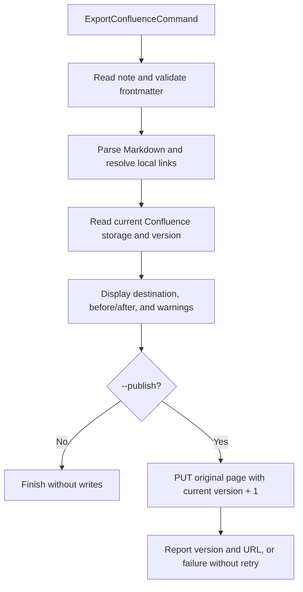

# Architecture

This Symfony console application moves content between Confluence Cloud and an Obsidian vault. Credentials and the vault root come from environment configuration; `config/services.yaml` binds gateway interfaces to SDK adapters. There is no application database.

## Import and local link resolution

`ImportConfluenceCommand` and `ImportConfluenceFolderCommand` use page/folder traversal services and `ConfluencePageImportPipeline`. `ConfluenceClient` fetches rendered view HTML through the Confluence v2 SDK. `ConfluenceContentConverter` cleans and converts that HTML through League HTML-to-Markdown. Obsidian writers persist YAML metadata, Markdown, and optional downloaded attachments. Import is lossy: rendered HTML is not the original Confluence storage representation.

`ResolveConfluenceLinksCommand` indexes imported notes and rewrites known Confluence links to Obsidian wikilinks. Its local writes are separate from export.

## Export

`ExportConfluenceCommand` orchestrates validation, conversion, preview, and optional publication. Classes under `src/Confluence/Export` provide these responsibilities:

- `ExportNoteReader` resolves a note inside a vault, validates imported frontmatter, and separates its body without writing locally.
- `ExportContentConverter` uses League CommonMark with table support and `WikiLinkParser`. It skips images/embeds with warnings, rejects detected unsupported syntax, and keeps code literal.
- `ExportLinkResolver` resolves local references to imported note identities, rejecting missing or ambiguous targets. `ConfluencePageUrl` constructs links on the configured site.
- `ConfluenceExportGatewayInterface` separates preview/publication from SDK transport. `ConfluenceExportClient` reads storage markup and submits one versioned replacement through the existing SDK factory. It leaves page location and attached files untouched.
- `ExportNote`, `ConvertedExport`, and `ExportPage` carry validated local input, conversion output, and observed remote state.

## Contracts and decisions

**2026-11-22 — Approved export design.** The selected Markdown file is authoritative for the existing page body. Remote-only edits are deliberately overwritten. Title and parent remain unchanged. Import-time versions are informational; the adapter fetches the current version and relies on the API to reject a concurrent update. A preview is not a persisted approval snapshot: each invocation rereads the file and remote page.

Export adds `app:confluence:export <note> [--vault=...] [--publish]` and a Confluence v2 `PUT /pages/{id}` call. Its JSON payload contains `id`, `status: current`, the observed title, a `storage` body, and the next version. There are no database or frontmatter schema changes. See the [export specification](docs/specs/confluence-export.md).

The installed SDK's generated `PagesIdPutBody` normalizer passes its body union through directly. The adapter supplies an associative array; supplying a `PageBodyWrite` object produces an empty JSON body. Transport-level tests protect this contract.

The site origin is configured, not stored in note metadata. The command cannot establish that a page ID came from that site. Attachment reconciliation, creating pages, automatic syncing, and lossless macro conversion are outside this version. Tests use local files and a queued HTTP transport; they do not establish live Confluence rendering fidelity or deployment configuration.
